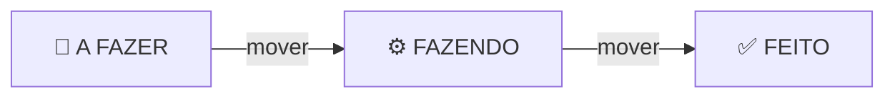
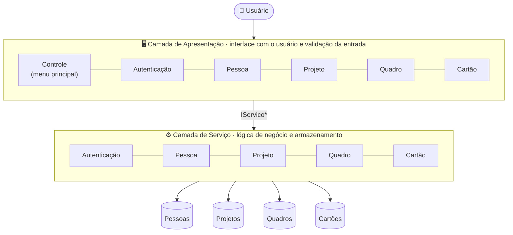
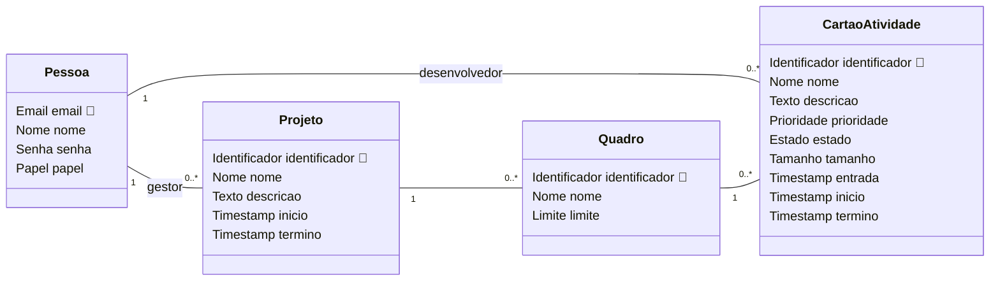

<div align="center">

# 📋 TP1 · Sistema de Gestão de Projetos

**Sistema de gestão de projetos com quadros e cartões de atividade, em C++ com arquitetura em camadas.**

Trabalho prático de **Técnicas de Programação 1 (CIC0197)** · Universidade de Brasília


[Sobre](#-sobre) ·
[Funcionalidades](#-funcionalidades) ·
[Arquitetura](#%EF%B8%8F-arquitetura) ·
[Como executar](#-como-executar) ·
[Estrutura](#-estrutura-do-projeto) ·
[Equipe](#-equipe)

</div>

---

## 📖 Sobre

O sistema apoia a gestão de projetos. Cada projeto possui quadros e cada quadro organiza **cartões de atividade** em três colunas:



- Cada membro do projeto é **gestor** ou **desenvolvedor**. O gestor de um projeto é quem o criou.
- Para usar o sistema, o usuário **cria uma conta** e **se autentica**.
- Cada quadro tem um **limite de WIP**: o número máximo de cartões que podem estar em **FAZENDO** ao mesmo tempo.

### Métricas do quadro

| Métrica | Como é calculada |
|---|---|
| ⏱️ **Tempo de ciclo** | Da entrada do cartão em **FAZENDO** até sua chegada em **FEITO** |
| ⏳ **Lead time** | Da entrada do cartão em **A FAZER** até sua chegada em **FEITO** |
| 📊 **Médias** | Média dos tempos de ciclo e dos lead times dos cartões do quadro |
| 🚧 **WIP** | Número de cartões na coluna **FAZENDO** |

---

## ✨ Funcionalidades

O sistema oferece **26 serviços**, além de criar conta e autenticar:

| Entidade | Serviços | 👔 Gestor | 💻 Desenvolvedor |
|---|---|:---:|:---:|
| **Pessoa** | Criar · Ler · Atualizar · Excluir · Listar | ✅ | ✅ |
| **Projeto** | Ler · Listar | ✅ | ✅ |
| | Criar · Atualizar · Excluir | ✅ | ❌ |
| **Quadro** | Ler · Listar | ✅ | ✅ |
| | Criar · Atualizar · Excluir | ✅ | ❌ |
| **Cartão de atividade** | Ler · Listar · Mover | ✅ | ✅ |
| | Ler tempo de ciclo (e médio) · Ler lead time (e médio) · Ler WIP | ✅ | ✅ |
| | Criar · Atualizar · Excluir | ✅ | ❌ |

<details>
<summary><b>📐 Regras de negócio</b></summary>
<br>

- Um cartão só se move de **A FAZER → FAZENDO** e de **FAZENDO → FEITO**, respeitando o limite de WIP do quadro.
- A **chave primária** de uma entidade (email ou identificador) não pode ser editada.
- As **multiplicidades** do diagrama de classes são sempre respeitadas.
- **Exclusão não gera inconsistência.** O sistema recusa excluir projeto que tem quadros, quadro que tem cartões e pessoa vinculada a projeto ou cartão. A ordem de exclusão é cartões → quadros → projeto → pessoa.
- A listagem mostra o identificador de cada entidade. A leitura mostra todos os dados da entidade.

</details>

---

## 🏛️ Arquitetura

O software segue o estilo **em camadas**. Os módulos se comunicam apenas por **interfaces**, declaradas em [`headers/interfaces.hpp`](headers/interfaces.hpp) como classes abstratas.



### Modelo de dados



<details>
<summary><b>🧩 Domínios e formatos válidos</b></summary>
<br>

Cada atributo é uma **classe domínio**. O `setValor` lança `std::invalid_argument` quando o formato é inválido.

| Domínio | Formato válido |
|---|---|
| `Email` | `parte-local@dominio`. Parte local com até 64 caracteres (a-z, 0-9, `.` e `-`). Domínio com até 255 caracteres, em partes separadas por `.` |
| `Estado` | `A FAZER`, `FAZENDO` ou `FEITO` |
| `Identificador` | 3 letras seguidas de 3 dígitos (ex.: `PRJ001`) |
| `Limite` | Inteiro de 1 a 25 |
| `Nome` | Até 15 caracteres: letras e espaços simples entre palavras |
| `Papel` | `GESTOR` ou `DESENVOLVEDOR` |
| `Prioridade` | `ALTA`, `MEDIA` ou `BAIXA` |
| `Senha` | 5 caracteres alfanuméricos, com pelo menos uma letra e um dígito |
| `Tamanho` | `GRANDE`, `MEDIO` ou `PEQUENO` |
| `Texto` | Até 30 caracteres. Começa com letra maiúscula e termina com ponto |
| `Timestamp` | `DIA-MES-ANO-HH:MM` (ex.: `15-MAR-2026-14:30`), com ano entre 2000 e 2099 e anos bissextos considerados |

</details>

---

## 🚀 Como executar

> [!NOTE]
> O sistema ainda está em desenvolvimento. Os passos abaixo valem para a versão integrada. O andamento pode ser acompanhado nas [milestones](https://github.com/augustoqas/TP1-TRABALHO/milestones).

### Pré-requisitos

- [Code::Blocks](https://www.codeblocks.org/downloads/) com MinGW, ou qualquer `g++` com suporte a **C++11**
- [Doxygen](https://www.doxygen.nl/) (opcional, para gerar a documentação)

### Opção 1 · Code::Blocks

1. Clone o repositório:
   ```bash
   git clone https://github.com/augustoqas/TP1-TRABALHO.git
   ```
2. Abra o arquivo de projeto `.cbp` no Code::Blocks.
3. Clique em **Build and run** (`F9`).

### Opção 2 · Linha de comando

```bash
g++ -std=c++11 -Wall -Wextra -Iheaders main.cpp sources/*.cpp -o tp1
./tp1
```

### Documentação

```bash
doxygen Doxyfile
```

A documentação é gerada em HTML a partir dos comentários das classes.

---

## 📁 Estrutura do projeto

```text
TP1-TRABALHO/
├── headers/            # Declarações (.hpp)
│   ├── interfaces.hpp  #   Interfaces entre os módulos
│   ├── <dominio>.hpp   #   Classes domínio (Email, Nome, Senha, ...)
│   └── <entidade>.hpp  #   Classes entidade (Pessoa, Projeto, ...)
├── sources/            # Implementações (.cpp)
├── main.cpp            # Ponto de entrada: monta as camadas e inicia o menu
└── README.md
```

---

## 🤝 Como contribuir

| | Convenção |
|---|---|
| 🌿 **Branches** | Uma por tarefa, a partir da `main`: `feat/email`, `feat/pessoa`, ... |
| 💬 **Commits** | Uma linha, no padrão `Feat: Implementa classe dominio Email` |
| 🔀 **Pull Requests** | Toda mudança entra na `main` por PR. Use `Closes #N` para fechar a issue |
| 📝 **Código** | Arquivos `.hpp`/`.cpp` em minúsculas, sem acentos e sem `using namespace std` nos headers |
| 📚 **Documentação** | Doxygen (`@brief`, `@param`, `@return`, `@throw`) em toda classe e membro público |

As tarefas e os responsáveis estão nas [issues](https://github.com/augustoqas/TP1-TRABALHO/issues). O padrão completo de código está na [issue #1](https://github.com/augustoqas/TP1-TRABALHO/issues/1).

---

## 👥 Equipe

<table align="center">
  <tr>
    <td align="center" width="220">
      <a href="https://github.com/augustoqas">
        <br/>
        <b>Augusto Queiroz</b>
      </a><br/>
      <sub>Projeto · Quadro · Timestamp<br/>Doxygen · Teste fumaça</sub>
    </td>
    <td align="center" width="220">
      <a href="https://github.com/flavio-dematos">
        <br/>
        <b>Flávio de Matos</b>
      </a><br/>
      <sub>Cartão de atividade · Métricas<br/>Projeto Code::Blocks</sub>
    </td>
    <td align="center" width="220">
      <a href="https://github.com/pedrobamaral">
        <br/>
        <b>Pedro Amaral</b>
      </a><br/>
      <sub>Pessoa · Autenticação · Interfaces<br/>Arquitetura · Integração</sub>
    </td>
  </tr>
</table>

---

<div align="center">
<sub>Desenvolvido para a disciplina <b>Técnicas de Programação 1</b> · Universidade de Brasília · 2026</sub>
</div>
