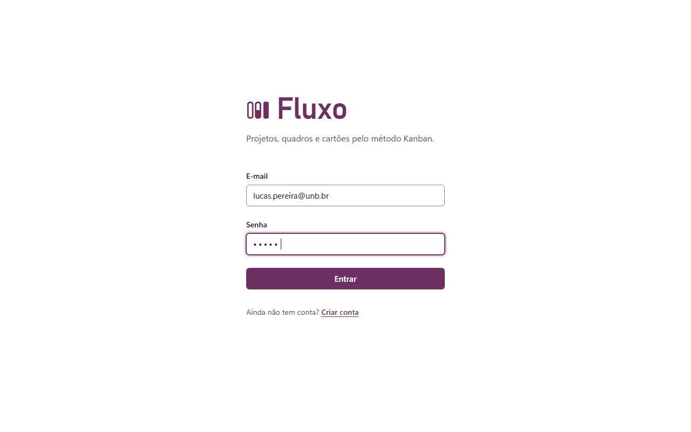
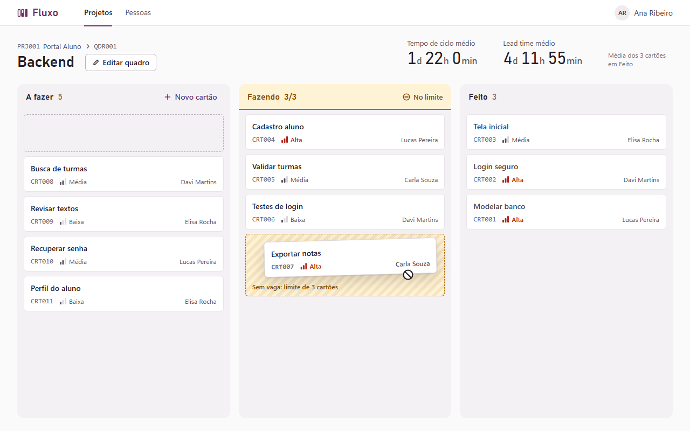
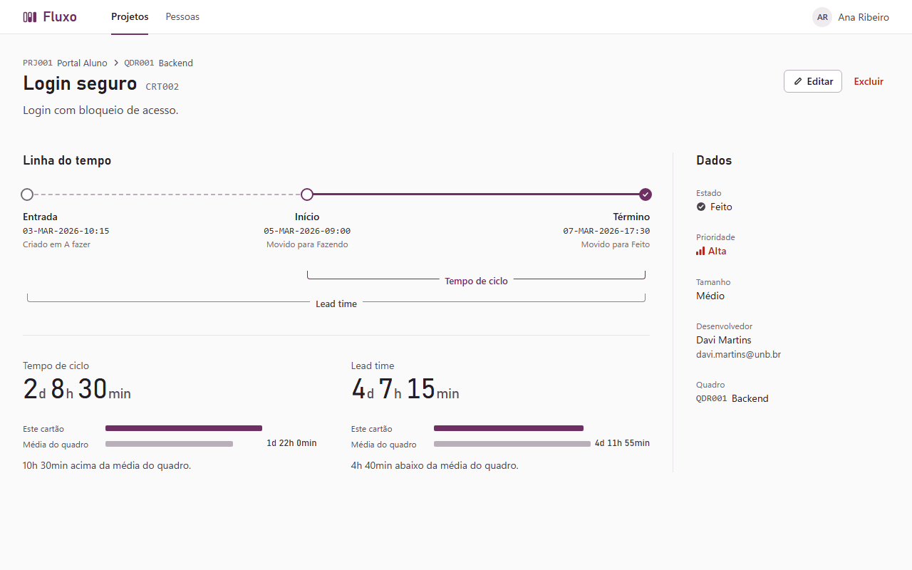
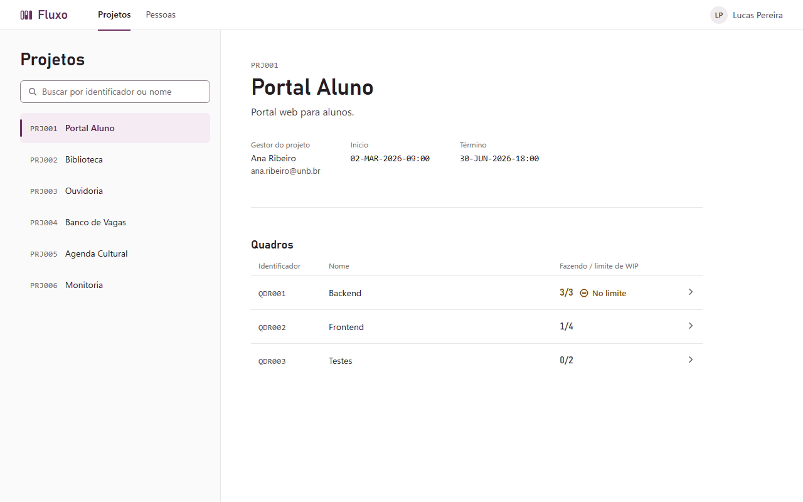

# Proposta de interface gráfica do Fluxo

O programa entregue usa a interface de console. Esta pasta reúne uma **proposta de interface gráfica** para o mesmo sistema: design, não implementação. As telas respeitam todos os requisitos funcionais e os formatos dos domínios do enunciado.

## Telas

| | |
|---|---|
|  |  |
| **Login** · uma coluna, uma ação | **Quadro** · limite de WIP comunicado pelo estado da coluna |
|  |  |
| **Cartão** · linha do tempo com tempo de ciclo e lead time | **Projetos** · visão de um desenvolvedor, sem ações de edição |

## Documentos

- [design-system.md](design-system.md): cores (com contraste WCAG calculado), tipografia, espaçamento, raios, componentes e regras de conteúdo. Folha visual: [design-system.png](design-system.png).
- [justificativas.md](justificativas.md): o porquê de cada decisão, com a referência que a sustenta.
- [critica.md](critica.md): os problemas da primeira versão que motivaram o redesenho.
- [referencias.md](referencias.md): fontes consultadas.
- [pesquisa/produtos.md](pesquisa/produtos.md): como Linear, Jira, Trello, GitHub Projects, Plane, Basecamp e Businessmap resolvem Kanban e métricas.
- [pesquisa/fundamentos.md](pesquisa/fundamentos.md): Refactoring UI, Laws of UX, WCAG 2.2, escala tipográfica, fontes e cor de marca.

## Em resumo

- **Identidade:** cor ameixa (`#6E2F63`), escolhida por ser o matiz mais distante de vermelho, âmbar e verde, para nunca se confundir com um estado. Tipografia Bahnschrift (DIN de sinalização) nos títulos e números.
- **Cor só com significado:** no quadro, só o limite de WIP e a prioridade alta têm cor.
- **Hierarquia por tipografia e espaço,** não por caixas. Sem CAIXA ALTA nos rótulos.
- **Regras que se explicam sozinhas:** o limite de WIP aparece no cabeçalho da coluna e no momento de arrastar; quem não é o gestor do projeto não vê as ações de edição e vê quem é o gestor.
